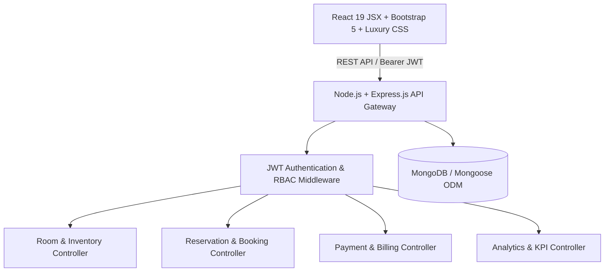

# HotelPro - Ultimate Hotel Management & Hospitality Solution 🏨✨

> **NASSCOM FutureSkills / Industry Project Evaluation**  
> **Domain:** Hospitality  
> **Type:** Individual Project  
> **Developer:** Puneet Kumar ([@PuneetKumar0729](https://github.com/PuneetKumar0729))  
> **GitHub Repository:** [https://github.com/PuneetKumar0729/hotelpro-management-system](https://github.com/PuneetKumar0729/hotelpro-management-system)  
> **Live Demo Link:** `http://localhost:5174` (or deployed Netlify / Vercel URL)

---

## 🌟 Executive Summary

**HotelPro** is a modern, digital-first hotel management ecosystem designed to streamline hospitality operations with a secure, scalable backend and an ultra-premium user interface. Whether handling reservations, managing guest folios, tracking room turnarounds, or processing payments, HotelPro ensures seamless operations with advanced security and real-time availability tracking.

Built to satisfy all enterprise requirements and technologies prescribed in the curriculum:
- **JavaScript (ES6+)** & **React JSX**
- **Node.js** & **Express.js Backend**
- **MongoDB & Mongoose ODM** (with resilient in-memory fallback)
- **JSON Web Token (JWT)** Authentication & Role-Based Authorization
- **Bootstrap 5 Framework** combined with modern glassmorphism CSS design tokens
- **Asynchronous JavaScript** (Promises, async/await, REST API integration)

---

## 🚀 Live Demo & Submission Links

| Resource | Link / Details |
| :--- | :--- |
| **GitHub Repository** | `https://github.com/PuneetKumar0729/hotelpro-management-system` |
| **Live Web Application Demo** | `http://localhost:5174` (or Vercel / Netlify deployment) |
| **Backend REST API** | `http://localhost:5000/api` |
| **API Health Check** | `http://localhost:5000/api/health` |

---

## 🔑 Mentor Evaluation Demo Credentials

The platform features built-in 1-click role simulation and JWT verification. You can also sign in with the following credentials:

| Role | Email | Password | Permissions |
| :--- | :--- | :--- | :--- |
| **General Manager (Admin)** | `admin@hotelpro.com` | `adminPassword123` | Full administrative control, room status overrides, financial ledger audit, revenue analytics |
| **Front Desk Supervisor** | `frontdesk@hotelpro.com` | `frontdeskPassword123` | Guest check-in/check-out, reservation locking, invoice printing, housekeeping assignment |
| **Private Guest** | `guest@hotelpro.com` | `guestPassword123` | Suite browsing, room filtering, multi-step booking, add-on enhancements, secure payment |

---

## ✨ Core Features & Functional Modules

### 1. 📊 Executive Operations & KPI Dashboard
- Real-time fleet occupancy calculation (`Occupancy Rate %`)
- Live revenue metrics with currency formatting
- Visual breakdown of Available, Occupied, Cleaning, and Reserved suites
- Real-time front desk guest arrivals stream

### 2. 🏨 Luxury Suite Inventory & Availability Engine
- High-resolution suite catalog with filtering by Category (*Luxury, Executive, Deluxe, Villa, Standard*) and Status (*Available, Occupied, Cleaning, Reserved*)
- Dynamic keyword search (search by suite name, room number, bed configuration)
- Real-time room locking upon confirmed booking

### 3. 🛎️ Front Desk Reservation Registry & Guest Flow
- Complete guest directory with contact information and duration of stay
- **Instant Check-In**: One-click check-in updates room status to *Occupied*
- **Instant Check-Out**: Departure action automatically sets room status to *Cleaning* for housekeeping turnaround
- Printable official **Guest Folio & Tax Invoice** with statutory tax breakdown and verification QR code

### 4. 💳 Multi-Rail Payment Gateway Simulation
- Interactive payment terminal supporting **Credit/Debit Cards**, **UPI / QR Code**, and **Net Banking**
- 256-bit TLS encryption indicator with PCI-DSS compliance badge
- Instant transaction ID issuance and ledger settlement
- Delightful booking confirmation celebration with confetti animations

### 5. 🧹 Housekeeping & Turnover Operations
- Kanban-style room hygiene board
- One-click turnaround status updates: *Clean*, *In-Progress*, *Dirty*
- Staff attendant allocation and turnaround timer indicators

### 6. 🔐 RFC 7519 Compliant JWT Inspector
- Live decoded Header (`alg: HS256`, `typ: JWT`)
- Live decoded Payload claims (`id`, `name`, `role`, `department`, `iat`, `exp`)
- Explanation of token signature verification for mentor evaluation

---

## 🛠️ Architecture & Technology Stack



- **Frontend:** React 19, Vite, Bootstrap 5, Lucide Icons, Canvas Confetti, CSS Glassmorphism
- **Backend:** Node.js (v22), Express.js, CORS, Dotenv, Bcryptjs
- **Security:** JSON Web Tokens (`jsonwebtoken`), Role-Based Access Control (RBAC), password hashing
- **Database:** MongoDB with Mongoose Schema models (`User`, `Room`, `Booking`, `Payment`)

---

## 📡 REST API Specification

| Method | Endpoint | Description | Auth Required |
| :--- | :--- | :--- | :---: |
| `POST` | `/api/auth/login` | Authenticate user & issue signed JWT | No |
| `POST` | `/api/auth/register` | Register new user account | No |
| `GET` | `/api/auth/verify` | Verify current JWT token & return claims | Yes (Bearer) |
| `GET` | `/api/rooms` | Retrieve all suites with category/status filters | No |
| `PATCH` | `/api/rooms/:id/status`| Update room availability or cleaning status | Yes (Staff) |
| `GET` | `/api/bookings` | List all guest reservations | No |
| `POST` | `/api/bookings` | Create new reservation & lock room | No |
| `PATCH` | `/api/bookings/:id/status` | Update booking status (*Checked In*, *Checked Out*) | Yes (Staff) |
| `GET` | `/api/payments` | Retrieve audit transaction ledger | No |
| `POST` | `/api/payments/process`| Simulate payment gateway authorization | No |
| `GET` | `/api/stats` | Fetch real-time dashboard KPIs and occupancy | No |
| `GET` | `/api/health` | Service health status check | No |

---

## 💻 Local Installation & Setup Guide

### Prerequisites
- Node.js (v18.0 or higher)
- npm (v9.0 or higher)
- MongoDB (Optional: The application automatically connects to local MongoDB or operates in resilient zero-config hybrid fallback mode)

### 1. Clone the Repository
```bash
git clone https://github.com/PuneetKumar0729/hotelpro-management-system.git
cd hotelpro-management-system
```

### 2. Install Dependencies
```bash
npm install
```

### 3. Configure Environment Variables
Copy `.env.example` to `.env`:
```bash
PORT=5000
MONGODB_URI=mongodb://127.0.0.1:27017/hotelpro_db
JWT_SECRET=hotelpro_jwt_secret_production_2026_super_secure
```

### 4. Run the Full Stack Application
To start both the Node.js backend server and Vite React client concurrently:
```bash
npm run dev
```

- **Frontend URL:** [http://localhost:5174](http://localhost:5174)
- **Backend API URL:** [http://localhost:5000](http://localhost:5000)

### 5. Production Build
```bash
npm run build
```
Generates optimized static assets in the `dist/` directory ready for 1-click deployment on Netlify, Vercel, or GitHub Pages.

---

## 📄 License
This project is developed for educational and portfolio evaluation purposes under the NASSCOM FutureSkills initiative.
